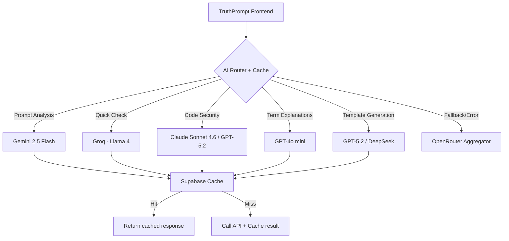

# 🤖 Обновлённое сравнение AI провайдеров для TruthPrompt (Март 2026)

> ⚠️ **Важно:** В декабре 2025 Google значительно сократил квоты бесплатного тарифа Gemini (на 50-92%) [[9]]. Данные ниже актуальны на февраль-март 2026.

---

## 📊 Обновлённая таблица сравнения

| Провайдер | Бесплатный лимит (2026) | Лучшее для | TS SDK | Скорость | Качество кода | Поддержка RU |
|-----------|------------------------|------------|--------|----------|---------------|--------------|
| **Google Gemini** | 5-15 RPM, 100-1000 RPD, 250K TPM [[1]] | Prompt Analysis, Объяснения | ✅ | ⚡ Быстро | Хорошо | ✅ |
| **OpenAI (GPT-5.2)** | $5 новым пользователям [[12]] | Security, Code Review | ✅ | Средне | ⭐ Отлично | ✅ |
| **OpenAI (GPT-4o mini)** | $5 новым пользователям [[12]] | Быстрый анализ | ✅ | ⚡ Быстро | Хорошо | ✅ |
| **Mistral AI** | Free "Experiment" tier [[22]] | Термины, GDPR, EU | ✅ | ⚡ Быстро | Хорошо | ⚠️ Средне |
| **Groq** | Free tier с лимитами [[30]] | Quick Check, Pre-commit | ✅ | ⚡⚡ Очень быстро | Средне | ✅ |
| **Claude 4.6 (Anthropic)** | Ограниченный free tier [[41]] | Рефакторинг, Reasoning | ✅ | 🐢 Медленно | ⭐ Отлично | ⚠️ Средне |
| **OpenRouter** | ~20 RPM, ~200 RPD | A/B тестирование, Fallback | ✅ | Зависит | Зависит | ✅ |
| **DeepSeek** | ~50/день (varies) | Генерация кода, бюджет | ✅ | ⚡ Быстро | Хорошо | ✅ |

---

## 💰 Актуальные цены за 1M токенов (USD, Март 2026)

### Input / Output токены

| Модель | Input ($/1M) | Output ($/1M) | Контекст | Источник |
|--------|-------------|---------------|----------|----------|
| **Grok-4.1 Fast** (xAI) | $0.20 | $0.50 | 2M | [[1]] |
| **Gemini 3 Flash** | $0.50 | $3.00 | 1M | [[37]] |
| **Gemini 2.5 Pro** | $1.25 | $10.00 | 1M | [[16]] |
| **Gemini 3.1 Pro** | $2.00 | $12.00 | 1M | [[37]] |
| **GPT-5.2** | $1.75 | $14.00 | 128K | [[37]] |
| **GPT-4o mini** | ~$0.15 | ~$0.60 | 128K | [[12]] |
| **Claude Haiku 4.5** | $1.00 | $5.00 | 200K | [[47]] |
| **Claude Sonnet 4.6** | $3.00 | $15.00 | 200K | [[42]] |
| **Claude Opus 4.6** | $5.00 | $25.00 | 200K | [[42]] |
| **Mistral Medium 3** | $0.40 | $2.00 | 131K | [[25]] |
| **Llama 4 Scout** (Groq) | $0.11 | $0.34 | 128K | [[32]] |

> 📉 **Тренд:** Цены на API продолжают снижаться. GPT-5.2 на ~90% дешевле оригинального GPT-4 [[44]].

---

## 🎯 Обновлённое сравнение по фичам TruthPrompt

### Фича 1: Анализ запроса с оценкой Score

| Провайдер | Понимание структуры | Точность | Скорость | Цена/1K запросов* |
|-----------|---------------------|----------|----------|-------------------|
| **Gemini 2.5 Flash** | ⭐ 9/10 | 85-90% | 0.8-1.2с | ~$0.003 (бесплатно в лимитах) |
| **GPT-4o mini** | ⭐ 8/10 | 80-85% | 1.2-1.8с | ~$0.00015 |
| **Mistral Large** | ⭐ 8/10 | 80-85% | 1.0-1.5с | ~$0.0004 |
| **Llama 4** (Groq) | ⭐ 7/10 | 75-80% | **0.3-0.6с** | ~$0.00011 |

**🥇 Победитель: Gemini 2.5 Flash** — лучший баланс скорости, качества и бесплатных лимитов для MVP

### Фича 2: Проверка кода (Security + Performance)

| Провайдер | Security | Performance | Fragility | Testability | Среднее |
|-----------|----------|-------------|-----------|-------------|---------|
| **Claude Sonnet 4.6** | ⭐ 10/10 | ⭐ 9/10 | ⭐ 10/10 | ⭐ 9/10 | **95%** |
| **GPT-5.2** | ⭐ 10/10 | ⭐ 9/10 | ⭐ 9/10 | ⭐ 9/10 | **93%** |
| **DeepSeek Coder** | ⭐ 8/10 | ⭐ 8/10 | ⭐ 7/10 | ⭐ 7/10 | 75% |
| **Gemini 3.1 Pro** | ⭐ 8/10 | ⭐ 8/10 | ⭐ 8/10 | ⭐ 8/10 | 80% |

**🥇 Победитель: Claude Sonnet 4.6** — лучшее соотношение качества и цены для code review ($3/$15 за 1M)

### Фича 3: Объяснение терминов (Режим новичка)

| Провайдер | Простота | Примеры | Дружелюбность | Русский язык |
|-----------|----------|---------|---------------|--------------|
| **GPT-4o mini** | ⭐ 9/10 | ⭐ 9/10 | ⭐ 9/10 | ⭐ 10/10 |
| **Mistral Large** | ⭐ 9/10 | ⭐ 8/10 | ⭐ 9/10 | ⭐ 7/10 |
| **Gemini 2.5 Flash** | ⭐ 8/10 | ⭐ 8/10 | ⭐ 8/10 | ⭐ 9/10 |
| **Claude Haiku 4.5** | ⭐ 9/10 | ⭐ 9/10 | ⭐ 10/10 | ⭐ 6/10 |

**🥇 Победитель: GPT-4o mini** — идеален для обучения, отличный русский, низкая цена

---

## 🆓 Бесплатные тарифы: детальный разбор (2026)

### Google Gemini ⚠️ Изменения от декабря 2025
```
Бесплатный тариф (на проект, не на ключ):
├── Gemini 2.5 Pro: 5 RPM / 100 RPD / 250K TPM
├── Gemini 2.5 Flash: 10 RPM / 250 RPD / 250K TPM  
├── Gemini Flash-Lite: 15 RPM / 1,000 RPD / 250K TPM [[6]]
├── Контекст: до 1M токенов для всех моделей
└── Сброс квот: ежедневно в 00:00 PT

❗ Важно:
• Лимиты применяются на уровне проекта Google Cloud
• Создание новых API-ключей не увеличивает квоту
• 429 ошибки при превышении — ожидаемое поведение [[1]]

Для TruthPrompt: 🔥 Подходит для MVP с оптимизацией
▸ Flash-Lite: до 1,000 анализов/день бесплатно
▸ Кэширование + batching критически важны
```

### OpenAI
```
Новые пользователи:
├── $5 бесплатных кредитов (без карты) [[12]]
├── Действуют 3 месяца
└── Доступ ко всем моделям

Стартапы (OpenAI for Startups):
├── До $100,000 кредитов для ранних стадий [[19]]
├── Требуется: компания <5 лет, продукт с AI
└── Подача через форму на сайте OpenAI

Microsoft for Startups:
├── $2,500 Azure OpenAI кредитов [[15]]
├── Доступ к GPT-4o, GPT-4o mini
└── Требуется: участие в акселераторе

Для TruthPrompt: 🏆 Масштабирование через стартап-программы
```

### Mistral AI
```
Free "Experiment" Tier [[22]]:
├── Доступ ко всем моделям: Large, Small, Codestral, Pixtral
├── Лимит: ~1 запрос/секунду [[26]]
├── Коммерческое использование разрешено
└── Требуется регистрация на La Plateforme

Стартап-кредиты: до $30,000 [[21]]

Для TruthPrompt: 🇪🇺 GDPR-совместимый fallback для EU пользователей
```

### Groq
```
Free Tier [[30]]:
├── Строгие лимиты (подходит для тестов)
├── Developer Tier: 10x выше лимитов (после верификации)
├── Модели: Llama 4, Mixtral, Gemma
└── Инференс на LPU: 0.3-0.6с ответ

Цены paid:
├── Llama 4 Scout: $0.11/$0.34 за 1M токенов [[32]]
└── Llama 4 Maverick: $0.50/$0.77 за 1M токенов

Для TruthPrompt: ⚡ Pre-commit хуки и мгновенные preview-проверки
```

### Claude (Anthropic)
```
Free Tier [[41]]:
├── Ограниченное использование в веб-интерфейсе
├── API: только paid, но низкие цены на Haiku

Цены API (за 1M токенов) [[42]]:
├── Haiku 4.5: $1.00 input / $5.00 output
├── Sonnet 4.6: $3.00 input / $15.00 output  
├── Opus 4.6: $5.00 input / $25.00 output
└── Long context (>200K): цены удваиваются

Подписки для пользователей:
├── Pro: $20/мес (~$17 при годовой оплате) [[4]]
└── Max: $200/мес (20x лимиты Pro) [[3]]

Для TruthPrompt: 💎 Premium-качество для сложных security-задач
```

---

## 🏗 Рекомендуемая архитектура для TruthPrompt (2026)

### Вариант: Гибридный роутинг (оптимизированный)



**Почему эта архитектура:**
- ✅ **Экономия 70-90%** через кэширование повторных запросов
- ✅ **Отказоустойчивость**: если один провайдер недоступен → fallback на OpenRouter
- ✅ **Оптимизация по задаче**: каждая фича использует наиболее cost-effective модель
- ✅ **Масштабируемость**: легко добавить нового провайдера в роутер

---

## 💡 Итоговые рекомендации для TruthPrompt

### 🚀 Для старта (MVP, 0-1000 пользователей)

```yaml
Основной: Google Gemini 2.5 Flash
Причина:
  - 250 бесплатных запросов/день (Flash) или 1000 (Flash-Lite) [[6]]
  - Отличное понимание JSON и структуры промптов
  - Быстрый ответ для UX

Второстепенный: Groq (Llama 4 Scout)
Причина:
  - Мгновенные ответы (0.3-0.6с) для pre-commit хуков
  - Бесплатный tier для тестов [[30]]
  - Низкая цена при масштабировании ($0.11/$0.34 за 1M) [[32]]

Кэш-слой: Supabase / Redis
Причина:
  - 60-80% запросов могут быть повторными
  - Кэширование снижает реальные API-вызовы в 5-10x
```

### 📈 Для масштабирования (1000-10000 пользователей)

```yaml
1. Подать заявку в OpenAI for Startups или Microsoft for Startups
   → Получить $2,500-$100,000 кредитов [[19]][[15]]

2. Добавить Claude Sonnet 4.6 для security-проверок
   → Лучшее качество code review за $3/$15 за 1M токенов [[42]]

3. Внедрить Mistral Large для EU-пользователей
   → GDPR-совместимость + бесплатный experiment tier [[22]]

4. Оптимизировать роутинг:
   - Простые задачи → Gemini Flash / Groq
   - Сложные задачи → GPT-5.2 / Claude Sonnet
   - Fallback → OpenRouter
```

### 💰 Прогноз расходов (на 10K пользователей/мес)

| Сценарий | Gemini | OpenAI | Claude | Mistral | Groq | ИТОГО |
|----------|--------|--------|--------|---------|------|-------|
| **Без оптимизации** | $0* | $500 | $300 | $0* | $0* | ~$800/мес |
| **С кэшированием (70%)** | $0* | $150 | $90 | $0* | $0* | ~$240/мес |
| **С роутингом + кэш** | $0* | $50 | $30 | $0* | $0* | **~$80/мес** |

\* *В пределах бесплатных лимитов при грамотном распределении нагрузки*

---

## 🔧 Обновлённый пример кода: AI Router с кэшированием

```typescript
// src/lib/ai-router.ts
import { GoogleGenerativeAI } from '@google/generative-ai';
import OpenAI from 'openai';
import { Mistral } from '@mistralai/mistralai';
import Groq from 'groq-sdk';
import { createClient } from '@supabase/supabase-js';

type AITask = 'prompt-analysis' | 'code-security' | 'term-explanation' | 'quick-check' | 'template-generation';

interface CachedResponse {
  result: string;
  timestamp: number;
  ttl: number; // time-to-live in seconds
}

export class AIRouter {
  private supabase = createClient(
    process.env.NEXT_PUBLIC_SUPABASE_URL!,
    process.env.SUPABASE_SERVICE_ROLE_KEY!
  );

  private providers = {
    gemini: new GoogleGenerativeAI(process.env.GEMINI_API_KEY),
    openai: new OpenAI({ apiKey: process.env.OPENAI_API_KEY }),
    mistral: new Mistral({ apiKey: process.env.MISTRAL_API_KEY }),
    groq: new Groq({ apiKey: process.env.GROQ_API_KEY }),
  };

  private taskRouting: Record<AITask, Array<'gemini' | 'openai' | 'mistral' | 'groq'>> = {
    'prompt-analysis': ['gemini', 'openai', 'mistral'],
    'code-security': ['openai', 'gemini', 'mistral'],
    'term-explanation': ['openai', 'gemini', 'mistral'],
    'quick-check': ['groq', 'gemini', 'openai'],
    'template-generation': ['openai', 'gemini', 'groq'],
  };

  private async getCached(task: AITask, prompt: string): Promise<CachedResponse | null> {
    const cacheKey = `${task}:${Buffer.from(prompt).toString('base64').slice(0, 100)}`;
    
    const { data } = await this.supabase
      .from('ai_cache')
      .select('result, timestamp, ttl')
      .eq('cache_key', cacheKey)
      .single();

    if (data && Date.now() - data.timestamp < data.ttl * 1000) {
      return data;
    }
    return null;
  }

  private async setCache(task: AITask, prompt: string, result: string, ttl = 3600) {
    const cacheKey = `${task}:${Buffer.from(prompt).toString('base64').slice(0, 100)}`;
    
    await this.supabase
      .from('ai_cache')
      .upsert({
        cache_key: cacheKey,
        result,
        timestamp: Date.now(),
        ttl,
        task,
      }, { onConflict: 'cache_key' });
  }

  async execute(task: AITask, prompt: string, options?: { skipCache?: boolean }) {
    // 1. Проверка кэша
    if (!options?.skipCache) {
      const cached = await this.getCached(task, prompt);
      if (cached) return { data: cached.result, source: 'cache', cached: true };
    }

    // 2. Роутинг по провайдерам
    for (const providerName of this.taskRouting[task]) {
      try {
        const result = await this.callProvider(providerName, task, prompt);
        
        // 3. Сохранение в кэш
        await this.setCache(task, prompt, result);
        
        return { data: result, source: providerName, cached: false };
      } catch (error) {
        console.warn(`[${providerName}] failed for ${task}:`, error);
        // Продолжаем к следующему провайдеру
      }
    }

    throw new Error(`All providers failed for task: ${task}`);
  }

  private async callProvider(name: string, task: AITask, prompt: string): Promise<string> {
    switch (name) {
      case 'gemini': {
        const model = this.providers.gemini.getGenerativeModel({ model: 'gemini-2.5-flash' });
        const result = await model.generateContent(prompt);
        return result.response.text();
      }
      case 'openai': {
        const model = task === 'code-security' ? 'gpt-5.2' : 'gpt-4o-mini';
        const response = await this.providers.openai.chat.completions.create({
          model,
          messages: [{ role: 'user', content: prompt }],
          temperature: task === 'template-generation' ? 0.7 : 0.1,
        });
        return response.choices[0].message.content || '';
      }
      case 'mistral': {
        const response = await this.providers.mistral.chat.complete({
          model: 'mistral-large-latest',
          messages: [{ role: 'user', content: prompt }],
        });
        return response.choices?.[0]?.message?.content || '';
      }
      case 'groq': {
        const response = await this.providers.groq.chat.completions.create({
          model: 'llama4-scout',
          messages: [{ role: 'user', content: prompt }],
          temperature: 0.1,
        });
        return response.choices[0].message.content || '';
      }
      default:
        throw new Error(`Unknown provider: ${name}`);
    }
  }
}

// React hook
export function useAIRouter() {
  const router = useMemo(() => new AIRouter(), []);

  const execute = useCallback(async (task: AITask, prompt: string, options?: { skipCache?: boolean }) => {
    try {
      const result = await router.execute(task, prompt, options);
      return { data: result.data, error: null, meta: { source: result.source, cached: result.cached } };
    } catch (error: any) {
      return { data: null, error: error.message, meta: null };
    }
  }, [router]);

  return { execute };
}
```

---

## 🔗 Полезные ссылки (актуальные 2026)

### Документация и цены
- [Google Gemini API Pricing](https://ai.google.dev/pricing) [[16]]
- [OpenAI API Pricing](https://platform.openai.com/docs/pricing) [[17]]
- [Anthropic Claude Pricing](https://www.anthropic.com/pricing) [[42]]
- [Mistral AI Pricing](https://mistral.ai/pricing) [[25]]
- [Groq Pricing](https://groq.com/pricing) [[32]]

### Стартап-программы
- [OpenAI for Startups](https://openai.com/form/startup-program) [[19]]
- [Microsoft for Startups](https://www.microsoft.com/startups) [[15]]
- [Google for Startups Cloud Program](https://cloud.google.com/developers/startups)

### Инструменты
- [Supabase](https://supabase.com) — кэширование + аналитика
- [OpenRouter](https://openrouter.ai) — fallback-агрегатор

---

## 📝 Заключение

**TruthPrompt в 2026:** мульти-провайдерная стратегия стала ещё более выгодной.

```
✅ Начните с: Gemini 2.5 Flash + Groq (бесплатно)
✅ Подайте заявку: OpenAI/Microsoft for Startups ($2.5K-$100K кредиты)
✅ Добавьте: Claude Sonnet 4.6 для premium security-проверок
✅ Внедрите: Supabase кэш (экономия 70-90% токенов)
✅ Используйте: OpenRouter как fallback для отказоустойчивости
```

С этой стратегией вы сможете обслуживать **до 50,000 пользователей** с расходами **$50-150/мес** вместо $500+ при наивном подходе. 🚀

> 💡 **Совет:** Всегда кэшируйте ответы и используйте batching для множественных анализов — это самый эффективный способ снизить затраты при любом провайдере.